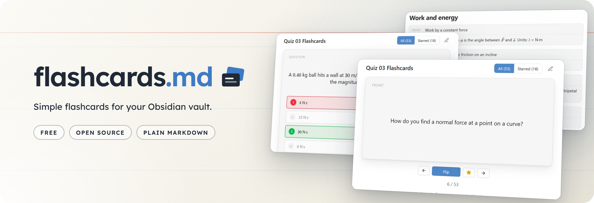
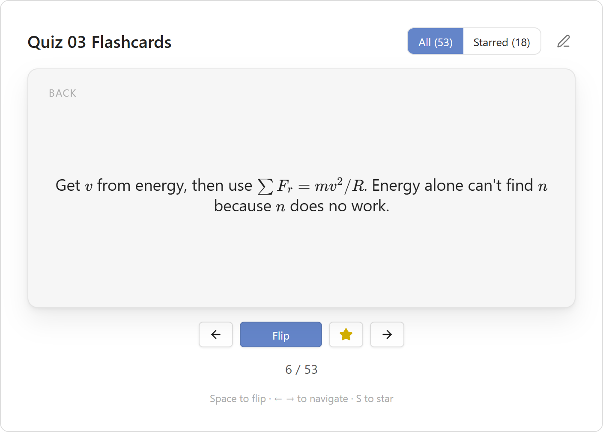
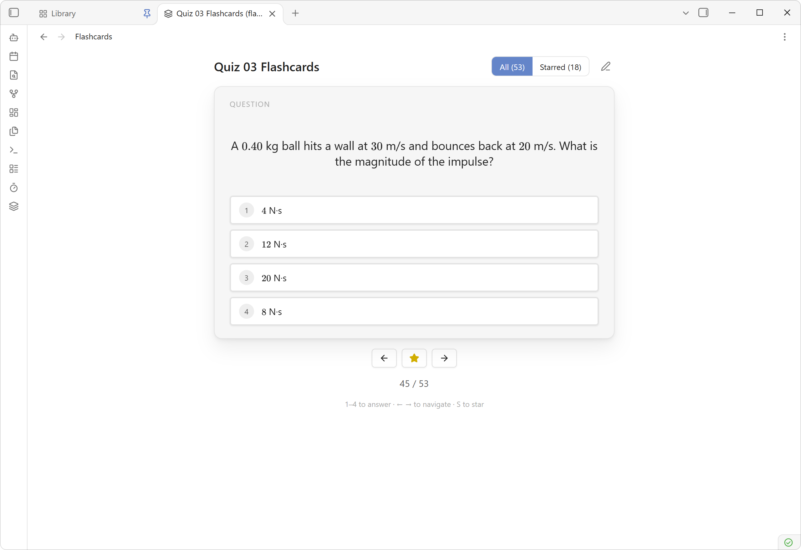
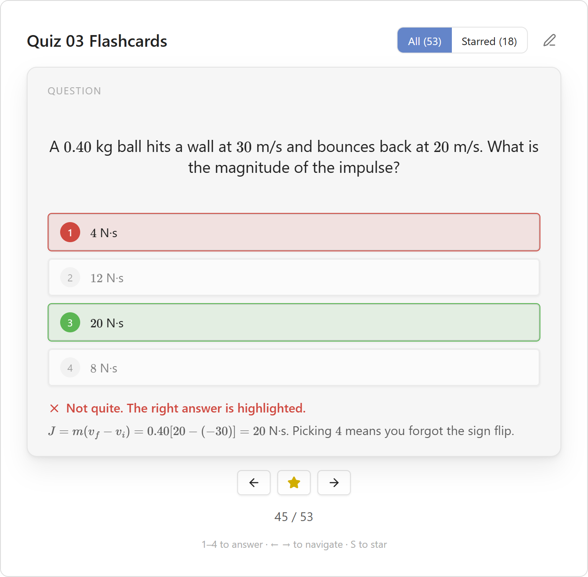
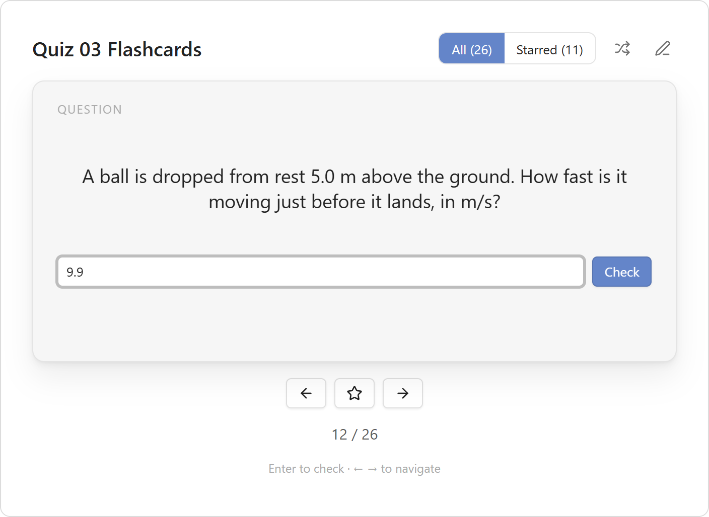
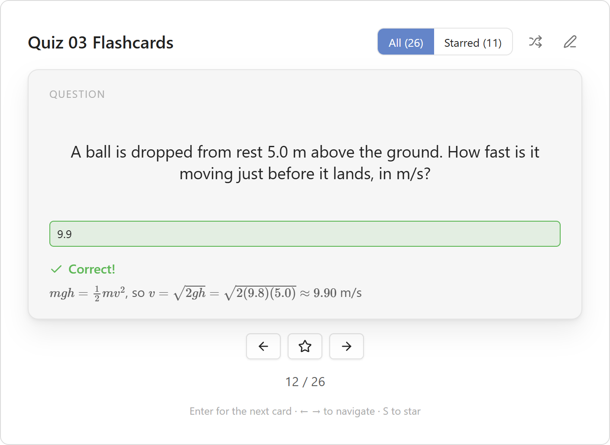
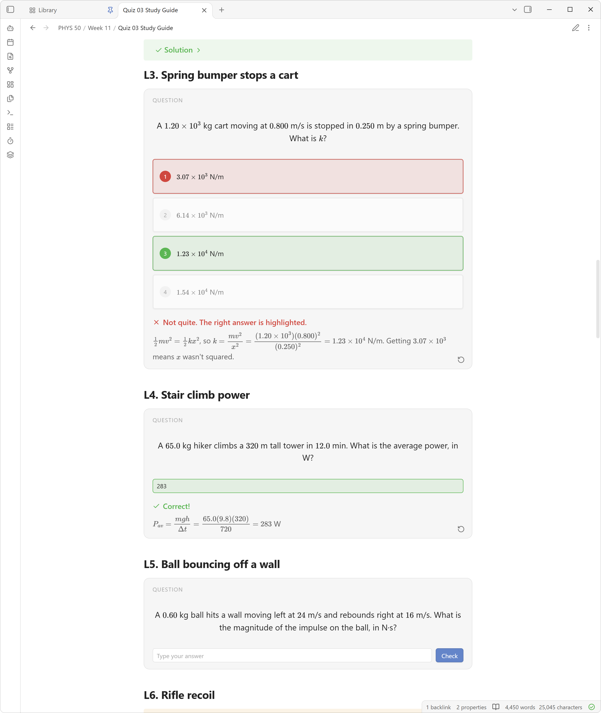

<div align="center">



</div>

---

<div align="center">

### Flashcards MD

An Obsidian plugin for writing flashcards in your notes, including [multiple-choice](#multiple-choice) and [typed-answer](#typed-answer) cards. Study them in a flip-card view, or right in the note with [inline cards](#playable-cards-in-notes).

<br/>

<p>
  
  
  <a href="https://www.gnu.org/licenses/gpl-3.0"></a>
</p>

</div>

<br/>

## Writing cards

Each `flashcard` code block is one card:

````markdown
```flashcard
front: What is the capital of France?
back: Paris
```
````

- Values can run over several lines. Any line that doesn't start with `front:`, `back:`, `answer:` or `starred:` continues the field above it.
- Markdown works on both sides, including bold, lists, links and images.
- In reading view, each block shows as a small front/back preview. To study a card right in the note instead, see [Playable cards in notes](#playable-cards-in-notes).

<p align="center">
  
  
</p>

### Multiple choice

Give a card options as a checklist instead of a `back:`, and mark the right one with `[x]`:

````markdown
```flashcard
front: Which planet is closest to the Sun?
- [ ] Venus
- [x] Mercury
- [ ] Mars
```
````

<p align="center">
  
  
</p>

In flashcard view, a multiple-choice card shows its options instead of flipping. Pick one to see if you got it right. The correct option turns green and a wrong pick turns red. If more than one option is marked `[x]`, any of them counts as right. You can still add a `back:` line, and it shows as an explanation after you answer.

Any `- [ ]` or `- [x]` line in a card is treated as an option, so don't use checklists inside a regular card's `back:`.

### Typed answer

Give a card an `answer:` instead of a `back:` to type the answer in yourself:

````markdown
```flashcard
front: What is the chemical symbol for gold?
answer: Au
```
````

<p align="center">
  
  
</p>

In flashcard view, type your answer and press `Enter` or **Check**. Matching ignores capitals, extra spaces and a trailing `.`, `!` or `?`. Anything else has to match exactly. For more than one accepted answer, add more `answer:` lines. If you get it wrong, the card shows the first answer. As with multiple choice, an optional `back:` shows as an explanation after you check.

For a number, give a range with `±` (or `+-`), either as an amount or a percent. A unit can follow it:

````markdown
```flashcard
front: A ball is dropped from 5.0 m. How fast is it going when it lands?
answer: 9.899 ± 0.05 m/s
```
````

Here anything within 0.05 of 9.899 counts, so `9.9` and `9.90` are right but `10` isn't. The unit is optional, but a different unit like `km/s` is marked wrong. `answer: 120 ± 5% N` accepts 114 to 126. Without a `±`, a number has to be exactly equal, though `56`, `56.0` and `5.6e1` all count.

While the answer box is selected, keys type into it instead of acting as shortcuts. `←` and `→` still change cards while the box is empty, and `Esc` leaves the box.

### Playable cards in notes

Write `flashcard-inline` instead of `flashcard` to make a card playable right in the note, in both reading view and Live Preview:

````markdown
```flashcard-inline
front: What is 7 × 8?
answer: 56
```
````



Instead of the front/back preview, the note shows the card itself. Click a regular card to flip it, pick an option on a multiple-choice card, or type into a typed-answer card. After answering, the ↺ button in the corner resets the card so you can try again. Inline cards also show up in flashcard view like any other card, and can be mixed with regular `flashcard` blocks in the same note.

## Studying

Open a note in flashcard view in any of these ways. The ribbon icon and the command are toggles, so using either again switches back to the normal note:

- the **layers** icon in the ribbon,
- the command **Flashcards MD: Toggle flashcard view**,
- right-clicking the note in the file explorer and choosing **Open in flashcard view**.

In the view:

| Action | Mouse | Key |
| --- | --- | --- |
| Flip card | Click the card or **Flip** | `Space` / `Enter` |
| Answer a multiple-choice card | Click an option | `1`–`9` |
| Check a typed answer | **Check** | `Enter` |
| Next card after answering | Arrow button | `Enter` |
| Previous / next card | Arrow buttons | `←` / `→` |
| Star / unstar | Star button | `S` |
| Show all or only starred cards | **All** / **Starred** toggle | |
| Shuffle, or go back to note order | Shuffle button | |
| Go back to editing | Pencil button | |

Stars are saved in the note as a `starred: true` line inside the card's block. They stay with the note when you sync, rename or move it.

## Other commands

- **Create new flashcard note** creates `Flashcards.md` with a few example cards.
- **Insert flashcard** adds an empty card at the cursor.
- **Insert multiple choice flashcard** adds an empty multiple-choice card with three options.
- **Insert typed answer flashcard** adds an empty typed-answer card.

## Development

```bash
npm install
npm run dev     # watch mode
npm run build   # type-check and production build
```

To install by hand, copy `main.js`, `manifest.json` and `styles.css` into `<vault>/.obsidian/plugins/flashcards-md/`. Then turn on the plugin under **Settings → Community plugins**.
