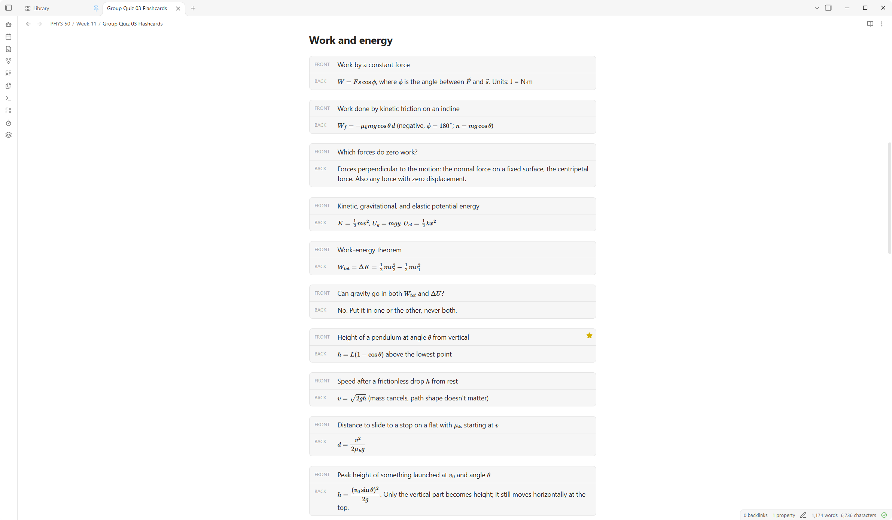

<div align="center">


</div>

# Flashcards MD

An Obsidian plugin for writing flashcards in your notes and studying them in a flip-card view.

<p align="center">
  
  
</p>

## Writing cards

Each `flashcard` code block is one card:

````markdown
```flashcard
front: What is the capital of France?
back: Paris
```
````

- Values can run over several lines. Any line that doesn't start with `front:`, `back:` or `starred:` continues the field above it.
- Markdown works on both sides, including bold, lists, links and images.
- In reading view, each block shows as a small front/back preview.



## Studying

Open a note in flashcard view in any of these ways. The ribbon icon and the command are toggles, so using either again switches back to the normal note:

- the **layers** icon in the ribbon,
- the command **Flashcards MD: Toggle flashcard view**,
- right-clicking the note in the file explorer and choosing **Open in flashcard view**.

In the view:

| Action | Mouse | Key |
| --- | --- | --- |
| Flip card | Click the card or **Flip** | `Space` / `Enter` |
| Previous / next card | Arrow buttons | `←` / `→` |
| Star / unstar | Star button | `S` |
| Show all or only starred cards | **All** / **Starred** toggle | |
| Go back to editing | Pencil button | |

Stars are saved in the note as a `starred: true` line inside the card's block. They stay with the note when you sync, rename or move it.

## Other commands

- **Create new flashcard note** creates `Flashcards.md` with two example cards.
- **Insert flashcard** adds an empty card at the cursor.

## Development

```bash
npm install
npm run dev     # watch mode
npm run build   # type-check and production build
npm run banner  # re-render docs/banner.png from docs/banner/banner.html
```

To install by hand, copy `main.js`, `manifest.json` and `styles.css` into `<vault>/.obsidian/plugins/flashcards-md/`. Then turn on the plugin under **Settings → Community plugins**.
